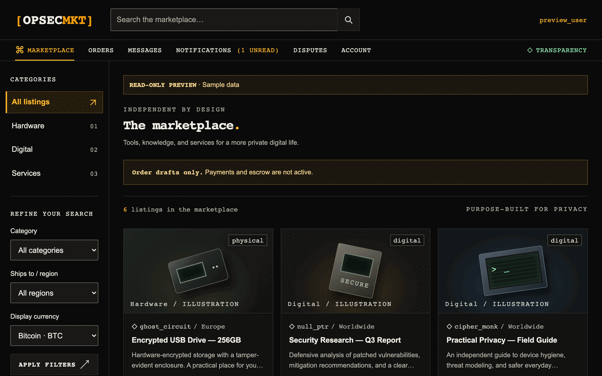
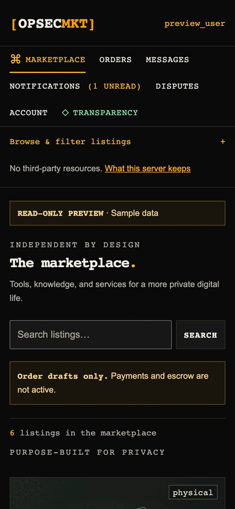
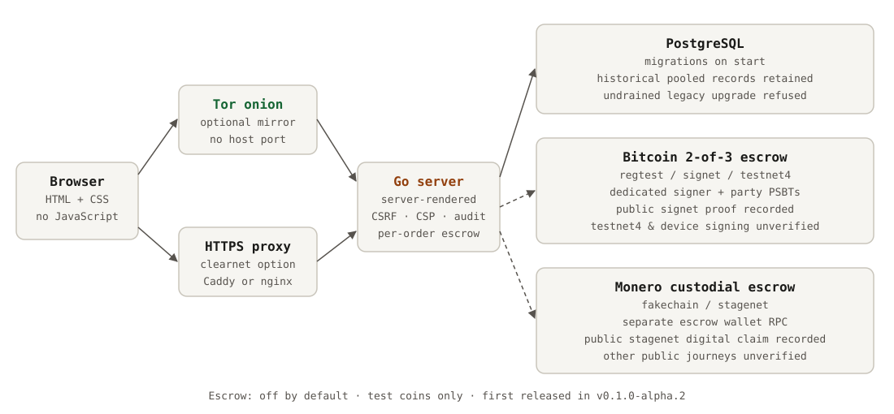

<div align="center">

<picture>
  <source media="(prefers-color-scheme: dark)" srcset="docs/assets/logo-dark.svg">
  <source media="(prefers-color-scheme: light)" srcset="docs/assets/logo-light.svg">
  
</picture>

### A self-hosted marketplace that needs no browser JavaScript

Server-rendered Go and PostgreSQL, PGP identity, Tor-first deployment.

[](https://github.com/yegamble/opsecmkt/actions/workflows/ci.yaml)

[Quick start](#quick-start) · [Self-host](#self-host) · [How it works](#how-it-works) · [Status](docs/implementation-status.md) · [Operator guide](docs/operator-guide.md) · [Contributing](CONTRIBUTING.md)

</div>

> [!IMPORTANT]
> **Pooled payments use test networks by default; mainnet is an explicit operator choice.** Per-order escrow is a
> separate path, built on the development branch but not released, and is off by default. Bitcoin escrow uses
> 2-of-3 signing; Monero escrow is custodial, not multisig. Neither escrow path has run on a public network. No
> public-testnet pooled-payment or mainnet-payment run is recorded. See the network matrix below, the
> [operator guide](docs/operator-guide.md#payments), and [per-order escrow](docs/escrow.md). Tor protects inbound
> connections to the site; it does not guarantee anonymity. See [implementation status](docs/implementation-status.md).

## Why OPSEC Market

Most marketplace software assumes a JavaScript-heavy browser and a stack of
third-party services. OPSEC Market is built for the opposite case: a visitor on
Tor Browser with scripts off, and an operator who runs everything on one host.

- **Nothing runs in the browser.** Pages are plain HTML and CSS with a strict
  Content Security Policy. There is no frontend build and no third-party asset.
- **Identity is PGP.** Users prove key ownership, can sign in with a PGP
  challenge or TOTP, and message each other in PGP ciphertext the server checks
  but cannot read.
- **The operator owns the instance.** One Docker Compose deployment, onion or
  clearnet, with signed audit exports and an operator-signed canary.

## What you get

| For | Capabilities |
| --- | --- |
| **Buyers** | Catalog search and filters, vendor profiles, order tracking, disputes, and reviews tied to a completed paid order (test network by default) |
| **Vendors** | Physical and digital listings with up to 4 photos each, an avatar, stock, automatic digital delivery, and a desk of orders to fulfil |
| **Moderators** | A dispute desk, payment-review flags, read-only access to disputed orders, and takedown of vendors' photos and avatars |
| **Administrators** | Roles, suspensions, second-factor resets, listing and photo takedowns, the public staff list, CAPTCHA and payment-intake controls, payout recovery, the canary and signed audit exports |
| **Operators** | One-command install, PostgreSQL inside or outside Compose, optional pruned test-network nodes, onion mirrors, encrypted backups |

### Payment and escrow networks

These paths have separate network guards. “Mainnet” here means real Bitcoin or Monero funds.

| Path | Networks and default | What the current evidence covers |
| --- | --- | --- |
| **Pooled wallet payments** | Optional wallet RPCs; test networks by default. Bitcoin accepts testnet3 (`test`), testnet4, signet and regtest; Monero accepts testnet and stagenet. Mainnet requires explicit `BITCOIN_CHAIN=main` and/or `MONERO_NETWORK=mainnet`. If both currencies are configured, both must be test networks or both mainnet. | Local-chain and simulated-RPC checks only. No public test-network or mainnet payment run is recorded. Pooled wallets are custodial; they are not multisig escrow. |
| **Bitcoin per-order escrow** (`ESCROW_BTC`) | Built on the development branch, not released; off by default. Bitcoin 2-of-3 signing accepts regtest, signet and testnet4; refuses mainnet and testnet3, and is refused in a mainnet-configured market. | Regtest and a private, isolated signet have been exercised. No public signet or testnet4 run is recorded; mainnet escrow is unsupported. |
| **Monero per-order escrow** (`ESCROW_XMR`) | Built on the development branch, not released; off by default. Accepts a local fakechain or stagenet; refuses Monero testnet and mainnet, and is refused in a mainnet-configured market. Custodial: the market can move these coins; this is not Monero multisig. | A local fakechain and an offline stagenet fork have been exercised. No public stagenet, testnet or mainnet run is recorded. |

The installer's local nodes default to Bitcoin **testnet4** and Monero **stagenet**. Set `BITCOIN_CHAIN=signet` for public signet or `BITCOIN_CHAIN=regtest` for an isolated local Bitcoin chain; `MONERO_NETWORK=testnet` selects Monero testnet for pooled payments. The configured wallet and node must report the selected network. Testnet3 is a legacy pooled-payment option and cannot be used for Bitcoin escrow.

The pooled payment path and escrow path have different settings and eligibility checks. See [mainnet pooled payments](docs/operator-guide.md#mainnet), [Bitcoin escrow's network limits](docs/operator-guide.md#bitcoin-escrow-test-networks-only), and [Monero escrow's network limits](docs/operator-guide.md#monero-escrow-fakechain-or-stagenet) before configuring real funds.

<table>
  <tr>
    <td width="72%"></td>
    <td width="28%"></td>
  </tr>
  <tr>
    <td colspan="2" align="center"><sub>Read-only preview with sample data and JavaScript disabled. Desktop and 390 px phone width.</sub></td>
  </tr>
</table>

## Quick start

Try the read-only preview. It needs only **Go 1.26.9 or newer**: no database,
wallet or Node.js.

```sh
go run ./cmd/server -preview
```

Open <http://127.0.0.1:8080>. The preview binds to loopback, shows labelled
sample data and rejects every form write. Stop it with <kbd>Ctrl</kbd>+<kbd>C</kbd>.

<details>
<summary>Port, loopback and toolchain notes</summary>

- To use another port, set `PREVIEW_ADDR`, for example
  `PREVIEW_ADDR=127.0.0.1:18080 go run ./cmd/server -preview`. It must be a
  loopback IP address and port (`127.0.0.1:…` or `[::1]:…`, not `localhost`);
  anything else stops the preview at startup. `ADDR` is ignored in preview mode.
- With the default `GOTOOLCHAIN=auto`, Go downloads the 1.27.2 toolchain pinned
  in `go.mod`. Set `GOTOOLCHAIN=local` to refuse the download.

</details>

## Self-host

You need Docker with Compose v2 (2.17 or later for Tor) and OpenSSL.

**Local marketplace in one command.** HTTP on loopback, internal PostgreSQL, no
wallets:

```sh
./scripts/install.sh --local
```

The installer writes a private `.env`, starts PostgreSQL and the app, and waits
until they are healthy. It then prints the setup link (normally
<http://127.0.0.1:8080/setup>) and a one-time setup token. Paste the token there
with your marketplace name and administrator account. Keep `.env` private: it
holds every secret.

**Onion service or production.** Choose the exposure; the installer asks the
rest, or nothing if you pass every flag (`./scripts/install.sh --help`):

```sh
./scripts/install.sh init --tor        # prints the onion address, setup link and token
./scripts/install.sh init --clearnet   # prints Caddy and nginx snippets for your HTTPS proxy
```

Add `--admin HANDLE` to create the administrator in the terminal instead of with
a token. For each coin the installer defaults to a pruned local test-network
node; `--nodes none` leaves payments off.

**Afterwards.** `status` shows health, setup state and onion addresses.
`add-mirror` adds a second onion address. `add-scanner` adds the ClamAV malware
scanner that photo uploads need (a host with at least 3 GiB of memory), and
`refresh-scanner` refreshes its signatures ([operator
guide](docs/operator-guide.md#photo-uploads-and-the-malware-scanner)). ClamAV
checks uploads for known malware; it does not review picture content. `upgrade`
brings a checkout up to date after `git pull`, with a backup first
([UPGRADING.md](UPGRADING.md)):

```sh
./scripts/install.sh status
AGE_RECIPIENT=age1... ./scripts/install.sh upgrade
```

The [operator guide](docs/operator-guide.md) covers HTTPS and Tor, mirrors,
port and project-name choices, node pruning, backups, upgrades and recovery.
`docker compose logs app` shows startup and migration errors; `docker compose
down` stops everything and keeps the data.

> [!WARNING]
> `docker compose down --volumes` deletes the marketplace's data. Use it only on
> an install you mean to destroy.

## How it works

<picture>
  <source media="(prefers-color-scheme: dark)" srcset="docs/assets/architecture-dark.svg">
  <source media="(prefers-color-scheme: light)" srcset="docs/assets/architecture-light.svg">
  
</picture>

A browser with scripts off reaches the Go server through a Tor onion service
(with an optional mirror address) or the operator's HTTPS reverse proxy. The
server renders every page, checks CSRF and origin on every form, and writes an
audit row in the same transaction as each action. PostgreSQL holds all state
and applies migrations on startup. Optional pooled Bitcoin Core and Monero
wallet RPCs use test networks by default; an operator may opt pooled payments
into mainnet, where enabled pooled currencies must agree on live versus test
network. Per-order escrow has separate guards, stays test-network-only, and is
off by default. The diagram gives the accepted network limits and the evidence
boundary for each payment path.

**What the server keeps.** There is no account, message or order deletion, and
the operator or anyone holding a decrypted backup can read what is stored.
Shipping addresses are never stored: buyers send them to the vendor
PGP-encrypted. Review text, dispute reasons, order
notes and digital delivery content are stored in plaintext. Listing photos and
avatars are kept only as re-encoded JPEGs without the uploaded file, its name or
its metadata; deleting one leaves copies in older backups. The full list is in
[what the server keeps](docs/implementation-status.md#what-the-server-keeps).

**Account recovery.** There is no forgotten-password reset. Recovery codes
replace a lost authenticator, and an administrator's password and second factors
are reset from the host with `-reset-admin-password` and `-reset-admin-factors`
(see the [operator guide](docs/operator-guide.md#authentication)).

## Documentation

| Guide | What it covers |
| --- | --- |
| [Operator guide](docs/operator-guide.md) | Deployment, HTTPS and Tor, mirrors, configuration, backups, recovery, troubleshooting |
| [Test-network payments](docs/testnet-runbook.md) | Wallet setup, funding and payout recovery |
| [Per-order escrow](docs/escrow.md) | The escrow design replacing the pooled wallet, what it will and will not protect, and its status (Phases 1 and 2: Bitcoin, digital and physical orders, regtest, signet or testnet4 (A-443; tested on regtest and a private signet, no public run recorded); Phase 3: custodial Monero, a local fakechain or stagenet (A-449; no public stagenet run recorded); all off by default) |
| [Upgrading from v0.1.0-alpha.1](UPGRADING.md) | New settings and migration steps |
| [Implementation status](docs/implementation-status.md) | What works, what is missing, and what the server keeps |
| [Acceptance checks](docs/acceptance.md) | The checklist, and the tests that prove each ticked line |
| [Verification](docs/verification.md) | Evidence table of CI runs and local chain runs |
| [Development and testing](docs/development.md) | Running from source, seeding data, every test suite |
| [Operations tests](docs/operations-tests.md) · [CI and releases](docs/ci-cd.md) · [Local chains](docs/local-chain-testing.md) | Rehearsals, pipelines and real regtest and stagenet runs |

## Project layout

| Path | Responsibility |
| --- | --- |
| `cmd/server/` | HTTP server, read-only preview and the host tools (`-bootstrap-admin`, `-reset-admin-password`, `-reset-admin-factors`, `-set-role`) |
| `cmd/verify-audit/` | Offline verifier for signed audit exports |
| `internal/market/` | Marketplace behaviour, database access and Go tests |
| `internal/market/migrations/` | Ordered SQL migrations; add new files, never rewrite merged ones |
| `web/` | Server-rendered templates and static CSS |
| `deploy/` | Tor image and `torrc`, the malware scanner's `clamd.conf` |
| `scripts/` | Installer, backup and restore, and operations checks |
| `tests/` | Playwright journeys (`tests/e2e/`: preview, database, wallet and, in the `browser-escrow` CI job, Bitcoin and Monero escrow against simulated nodes) and installer tests |
| `docs/` | Status, acceptance, operator runbooks and README assets |

## Contributing

Read [CONTRIBUTING.md](CONTRIBUTING.md) for the ground rules, the test gates and
the review loops. Development setup and every test suite are in
[docs/development.md](docs/development.md).
